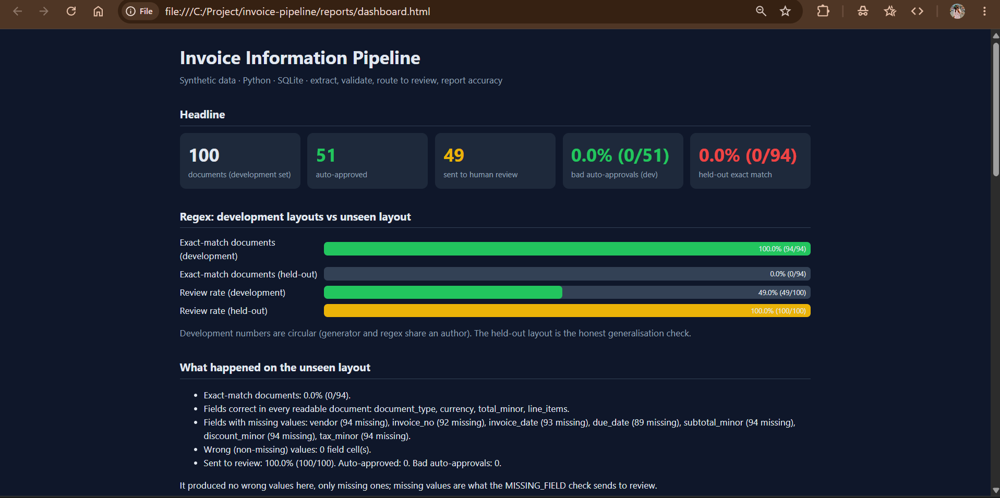
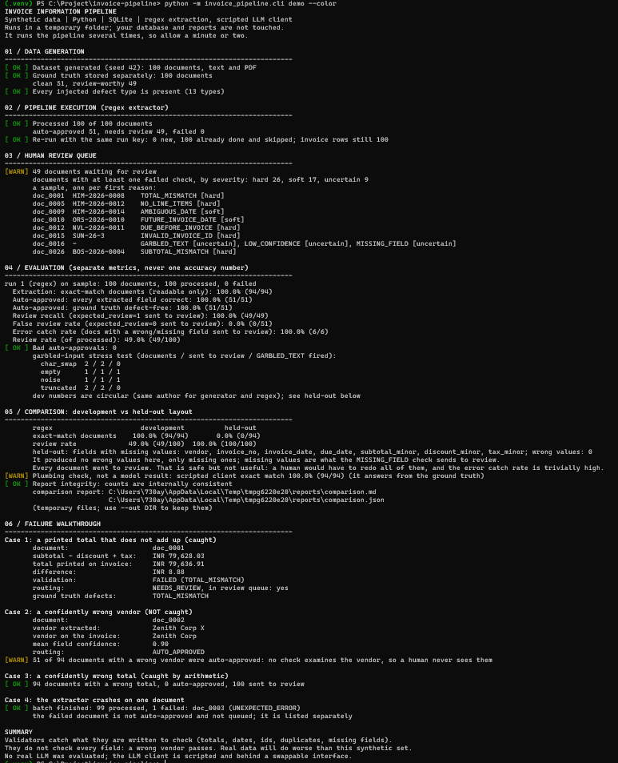

# Invoice Information Pipeline
Extract fields from synthetic invoices, validate totals and dates, route uncertain or wrong
extractions to human review, and report accuracy. Python + SQLite. No paid API, no secrets.
Author: <YOUR NAME>


## What it does
1. **Generate** 100 synthetic invoices (text and text-based PDF) with ground truth. Fixed seed, so the data is reproducible. About half are clean, half carry deliberate defects.
2. **Extract** fields behind a swappable `Extractor` interface (regex baseline, scripted LLM client).
3. **Validate** independently: totals, dates, invoice id format, duplicates, missing fields, garbled text, confidence.
4. **Route**: any failed check sends the document to a human review queue. Documents that cannot be read at all are listed as failed, never auto-approved.
5. **Store** everything in SQLite (money as integer paise, ground truth in separate tables).
6. **Evaluate** with three separate metrics, never one accuracy number.
## Quick start (Windows PowerShell)
```powershell
py -3.11 -m venv .venv
.\.venv\Scripts\Activate.ps1
pip install -r requirements.txt
pip install -e .
python -m pytest -q
python -m invoice_pipeline.cli demo
```
If `pip install -e .` fails on your machine (for example a sandboxed Windows setup), skip it and run `$env:PYTHONPATH = "src"` (PowerShell) or `export PYTHONPATH=src` (bash) in each new terminal; everything else works the same.

`demo` runs everything in a temporary folder with freshly generated data (1-3 minutes) and
touches nothing else. Add `--color` for coloured status tags, `--out reports` to keep the
generated reports, `--verbose` to list every review-queue document.
Python 3.11 was used. Any recent Python 3.10+ should work, but only 3.11 was tested.
## Commands
```powershell
$env:PYTHONPATH = "src"
python -m invoice_pipeline.cli generate --out data/sample          # synthetic data + ground truth
python -m invoice_pipeline.cli run --data data/sample --db invoices.db --extractor regex
python -m invoice_pipeline.cli review-queue --db invoices.db       # documents waiting for review
python -m invoice_pipeline.cli evaluate --data data/sample --db invoices.db
python -m invoice_pipeline.cli run --data data/heldout --db heldout.db --extractor regex
python -m invoice_pipeline.cli evaluate --data data/heldout --db heldout.db
python -m invoice_pipeline.cli run --data data/sample --db llm.db --extractor llm
python -m invoice_pipeline.cli evaluate --data data/sample --db llm.db
python -m invoice_pipeline.cli fault-demo --data data/sample       # confidently wrong extractors
python -m invoice_pipeline.cli compare                             # reports/comparison.md
python -m invoice_pipeline.cli dashboard --db invoices.db          # reports/dashboard.html
```
`run --run-key NAME` makes a retry resume the same run: finished documents are skipped, nothing duplicates.
Configuration is read from environment variables (see `.env.example`): `EXTRACTOR`, `DB_PATH`,
`LLM_BACKEND`, `LLM_MOCK_DATA`. No secrets are needed anywhere.
## Architecture
```
generate (seeded)  ->  txt + text PDF + ground-truth JSON
        |
     ingest   (read failure is NOT the same as garbled content)
        |
 Extractor interface  <- RegexExtractor (baseline)
                      <- LLMExtractor(client)  <- MockLLMClient (scripted; Ollama is future work)
        |
     validate  (pass / fail / skip per check, duplicate context from earlier documents)
        |
      route    (any failed check -> review)
        |
 SQLite: invoices, line_items, field_confidence, validation_results, review_queue
        |
    evaluate  (reads ground-truth tables, never writes them)  ->  reports/*.md, *.json
        |
 compare / dashboard / demo
```
Module map (`src/invoice_pipeline/`): `rules.py` (single source of truth for severity, policy and
duplicate rules, used by both the generator and the validator), `generate.py`, `dataset.py`,
`render.py`, `ingest.py`, `extractors/`, `validate.py`, `route.py`, `pipeline.py`, `db.py`,
`evaluate.py`, `compare.py`, `dashboard.py`, `demo.py`, `cli.py`.
## Data model
```
runs 1--* invoices *--1 documents 1--1 gt_documents 1--* gt_defects
              |                            \--* gt_line_items
              |--* line_items
              |--* field_confidence
              |--* validation_results     (detected defects, one row per check that ran)
              \--0..1 review_queue
```
- Money is `Decimal` in Python and integer paise in SQLite. Conversion rejects fractional paise and floats.
- `gt_*` tables hold ground truth and are written only by the ground-truth loader. Expected and detected defects are never mixed.
- A skipped check writes no row; `MISSING_FIELD` is never skipped, so absent data cannot slip through quietly.
- Schema: `sql/schema.sql`. Evaluation queries: `sql/queries.sql`.
## Validation checks
| Severity | Checks |
|---|---|
| Hard | `TOTAL_MISMATCH`, `SUBTOTAL_MISMATCH`, `DUE_BEFORE_INVOICE`, `NO_LINE_ITEMS`, `INVALID_INVOICE_ID`, `DUPLICATE_INVOICE` |
| Soft | `AMBIGUOUS_DATE`, `FUTURE_INVOICE_DATE`, `NEGATIVE_AMOUNT_ON_INVOICE`, `CREDIT_NOTE_SIGN_MISMATCH`, `DUPLICATE_ID_CONFLICT` |
| Uncertain | `MISSING_FIELD`, `GARBLED_TEXT`, `LOW_CONFIDENCE` |
Definitions (all in `rules.py`):
- Rounding tolerance 0.01; the as-of date is fixed (2026-10-10), not `today()`.
- Invoice id pattern `^[A-Z]{2,4}-\d{4}-\d{3,6}$`, checked exactly as printed.
- `DUPLICATE_INVOICE`: same normalised vendor and id, same date and total. `DUPLICATE_ID_CONFLICT`: same vendor and id, different date or total. Different vendor with the same id is not flagged.
- Credit notes carry negative amounts and use the same formula `subtotal - discount + tax = total`. A positive credit note, or a negative normal invoice, is flagged.
- A missing due date is valid. A due date that is printed but unreadable is a `MISSING_FIELD`.
- `LOW_CONFIDENCE` threshold 0.80 on `mean_required_field_confidence`. Confidence is a review signal, not proof of correctness.
- `GARBLED_TEXT` thresholds (junk ratio above 0.05, recognised lines below 0.50) were fixed before looking at results.
## Results
All numbers below come from `reports/comparison.md` (generated, not typed in). The data is synthetic.
| Metric | Development (layouts A-D) | Held-out (layout E) |
|---|---|---|
| Exact-match documents | 100.0% (94/94) | 0.0% (0/94) |
| Bad auto-approvals | 0 of 51 | n/a (0 auto-approved) |
| Review recall | 100.0% (49/49) | 100.0% (49/49) |
| False review rate | 0.0% (0/51) | 100.0% (51/51) |
| Review rate | 49.0% (49/100) | 100.0% (100/100) |
- **Development numbers are circular.** The generator and the regex extractor share an author and a label vocabulary, so 100% proves the plumbing, not generalisation.
- **Held-out layout:** the regex baseline read only document type, currency, total and line items. Vendor, invoice number, dates, subtotal, discount and tax were left empty. It produced **0 wrong values, but 0 of 94 documents were fully right**. Missing values trigger `MISSING_FIELD`, so all 100 documents went to review and nothing was auto-approved. That is safe but not useful.
- **Confidently wrong extractors (scripted):** a wrong total is caught by arithmetic (0 auto-approved). A wrong vendor is **not** caught: 51 of 94 such documents were auto-approved, because no check examines the vendor.
- **Garbled-input stress test:** all 6 corrupted documents were sent to review. `GARBLED_TEXT` itself fired for the `empty` and `noise` modes but not for `char_swap` or `truncated`; those were caught by other checks. Thresholds were not tuned afterwards.
## Failure demonstration
`demo` stage 6 shows four cases from the real run: a printed total that does not add up (doc_0001: calculated INR 79,628.03, printed INR 79,636.91, difference 8.88, routed to review); a confidently wrong vendor that is auto-approved; a confidently wrong total that is caught; and an extractor crash on one document where the batch carries on and the failed document is listed separately (not queued, not approved).
## Tests
```powershell
$env:PYTHONPATH = "src"
python -m pytest -q
```
216 tests: rules, generator, dataset, database constraints and rollback, ingest, regex extractor, validators (every check pass/fail/skip, boundaries), router, pipeline (resume, failure isolation), evaluation (hand-built databases, a deliberately bad extractor), LLM extractor failure modes, comparison, demo, dashboard. The full suite takes several minutes because many tests run the pipeline.
## Assumptions
- Input is text-based TXT or PDF with a real text layer; there is no OCR.
- Currency is INR. Numeric dates are read day-first (DMY); a numeric date that can be read two ways is flagged, not guessed.
- A missing due date is valid (not every invoice has one). Future-dated invoices are a soft warning controlled by a policy setting, not a hard error.
- "Incremental data": re-running with the same `--run-key` skips documents already processed and creates no duplicate rows; a run without a key is a new run.
- The as-of date is fixed in `rules.py` so results are reproducible.
## AI component
- **Input to the model:** the extracted document text inside a fixed prompt that asks for one JSON object (document type, vendor, invoice number, dates exactly as printed, money as plain decimal strings, line items, null for anything not printed).
- **Output expected:** strict JSON. Money must be a string with a dot and at most two decimals (floats are rejected); dates are parsed by our code, not the model.
- **Wrong or unusable output:** invalid or truncated JSON, an empty reply, or a client exception never raises. The result is empty with an `llm_error` signal, so `MISSING_FIELD` fails and the document goes to review. Unparseable single values become missing, not guessed.
- **Confidence:** the model's own confidence is not trusted. A fixed placeholder is used (0.9 when a value was returned and parsed, 0.0 otherwise); validators are the real check.
- **Isolation:** only `LLMClient.complete(prompt) -> str` talks to a model. The only client implemented is a scripted mock; a local model such as Ollama is future work.
## AI tools and external resources
An AI assistant (Claude) was used to help design and write this project; I reviewed and ran the code and can explain it. Libraries: `pdfplumber` (read PDFs), `reportlab` (write sample PDFs), `Faker` (listed in requirements), `pytest`, `requests`; everything else is the Python standard library (`sqlite3`, `decimal`, `argparse`).
## Limitations (read these)
- The data is synthetic. Real invoices will behave worse. Nothing here is a real-world accuracy claim.
- **No real LLM was evaluated.** `LLMExtractor` and its client interface are implemented and tested, but the only client is a scripted mock that answers from the ground truth. It verifies plumbing, not model accuracy. A local model client (for example Ollama) is future work; the interface is ready.
- Regex accuracy on layouts A-D is circular (see above). Layout E is one unseen layout and one seed.
- Each defect type has only 3-5 examples, so percentages are shown with n/N and strong claims are not supported.
- Zero false positives on clean documents is a result on this dataset, not a guarantee.
- Two errors that cancel each other (a consistently wrong subtotal and total) cannot be caught by arithmetic checks. Fields no check examines (such as the vendor) can be confidently wrong and approved.
- Input is text-based TXT/PDF only. There is no OCR; scanned PDFs are reported as failed (`NO_TEXT_LAYER`, meaning no extractable text, which does not prove the PDF is image-based). Indian digit grouping (`1,23,456.00`) is not supported.
- A resumed run does not re-evaluate documents already processed.
## Next steps
Real local LLM client behind the existing interface; a vendor check against a known-vendor list; OCR for scanned PDFs; learning from reviewer corrections; fuzzy vendor matching for duplicates.
